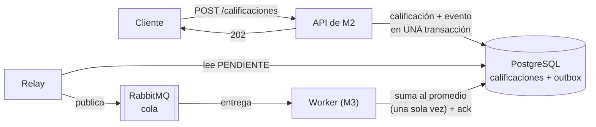

# Demo: colas de mensajes + Transactional Outbox

**Desarrollo de Software 2026 · UTN FRRe · Grupo 1**
Trabajo de investigación, Par 04: **Tema 2** (Colas de mensajes y procesamiento asíncrono) y **Tema 27** (Patrón Transactional Outbox).

> **Documento de investigación:** [`documento-investigacion.pdf`](documento-investigacion.pdf).
>
> **Base de datos:** el TPI usa MongoDB, pero esta demo es un proyecto aparte y usa **PostgreSQL**, donde la transacción del outbox se ve de forma directa (dos `INSERT` y un `COMMIT`).

## Qué demuestra

Un cliente califica al conductor después de un viaje. **M2 (Clientes)** guarda la calificación y responde al instante. **M3 (Conductores)** suma esa calificación al promedio del conductor después, cuando le llega el aviso por una cola.



| Archivo | Tema | Qué hace |
|---|---|---|
| `app/api.py` | Outbox | Guarda la calificación y el evento `ConductorCalificado` en la misma transacción. No se conecta a RabbitMQ. También tiene la versión **sin outbox**, para comparar. |
| `app/relay.py` | Outbox | Cada 1 s publica los eventos `PENDIENTE` y los marca `PUBLICADO`. Si RabbitMQ está caído, reintenta. |
| `app/worker.py` | Colas | Consume de a un mensaje, con ack manual. Es idempotente: un evento repetido no se suma dos veces al promedio. |
| `app/mensajeria.py` | Colas | Conexión con RabbitMQ: cola durable, mensajes persistentes y confirmación de publicación. |

## Cómo levantarlo

Requisito: **Docker Desktop** abierto. Python, PostgreSQL y RabbitMQ corren en contenedores.

```powershell
cd C:\Proyectos\2026-01-investigacion
docker compose up -d --build
```

- Consola de RabbitMQ: http://localhost:15672 (usuario `demo`, contraseña `demo`), pestaña *Queues*.
- Logs: `docker compose logs -f relay worker`.
- Si la API de M2 del TPI ya usa el puerto 8000, copiá `.env.example` como `.env` y poné `API_PORT=8001`.

Atajo para PowerShell (vale para la sesión abierta):

```powershell
function demo { docker compose exec api python -m scripts.demo @args }
```

| Comando | Qué hace |
|---|---|
| `demo calificar 5` | El cliente califica 5 veces al conductor "carlos" |
| `demo calificar 1 --sin-outbox` | Califica con la versión sin outbox |
| `demo resumen` | Calificaciones guardadas (M2), estado del outbox, calificaciones contadas en el promedio (M3) y mensajes en la cola |
| `demo duplicar` | Hace que el relay publique otra vez el último evento |

La regla para leer el resumen: **"guardadas" (M2) y "contadas" (M3) tienen que terminar siendo iguales**. Si guardadas es mayor, se perdió un evento; si contadas es mayor, se contó un duplicado.

## Escenarios de la demostración

### 1. Flujo normal

```powershell
demo calificar 1
demo resumen
```

Responde `202` en milisegundos. Unos 3 segundos después, la calificación está contada en el promedio.

### 2. El worker está detenido (colas)

```powershell
docker compose stop worker
demo calificar 4
demo resumen                  # la cola tiene 4 mensajes esperando
docker compose start worker
demo resumen                  # (después de unos segundos) contadas = guardadas
```

La API sigue respondiendo `202`. Los mensajes esperan en la cola y el worker los procesa cuando vuelve.

### 3. El worker se cae a mitad de un mensaje (colas)

```powershell
demo calificar 1
docker compose kill worker      # dentro de los 3 segundos
demo resumen                     # el mensaje volvió a la cola
docker compose start worker
```

El worker no llegó a mandar el ack, así que RabbitMQ devolvió el mensaje a la cola. El log dice `recibido (reentregado)`.

### 4. RabbitMQ está caído (outbox)

```powershell
docker compose stop rabbitmq
demo calificar 3
demo resumen                  # outbox: PENDIENTE 3
docker compose start rabbitmq
demo resumen                  # (después de unos segundos) todo PUBLICADO y contado
```

La API sigue respondiendo `202` porque no habla con RabbitMQ. Los eventos esperan en la tabla `outbox` y el relay los publica cuando RabbitMQ vuelve.

### 5. La misma falla sin outbox

```powershell
docker compose stop rabbitmq
demo calificar 1 --sin-outbox
docker compose start rabbitmq
demo resumen
```

Responde `500`: la calificación se guardó, pero el evento se perdió. El resumen queda con **una guardada más que las contadas**, para siempre.

### 6. Evento duplicado (consumidor idempotente)

```powershell
demo duplicar
demo resumen
```

Simula que el relay publicó un evento y se cayó antes de marcarlo: lo publica otra vez. El worker muestra `DUPLICADO` y las contadas no cambian. Sin idempotencia, la misma calificación se sumaría dos veces y el promedio quedaría mal.

### Empezar de cero

```powershell
docker compose down -v
```

## Pruebas

```powershell
docker compose --profile test run --rm tests
```

Usan PostgreSQL y RabbitMQ reales, con su propia base y su propia cola. También corren en GitHub Actions en cada push.

| Prueba | Qué verifica |
|---|---|
| `test_guarda_la_calificacion_y_el_evento_juntos` | La API responde 202 y guarda calificación y evento |
| `test_si_falla_el_evento_tampoco_queda_la_calificacion` | Atomicidad: si falla el segundo INSERT, se deshace el primero |
| `test_el_relay_publica_y_marca_los_pendientes` | El relay publica y marca `PUBLICADO` |
| `test_con_rabbitmq_caido_el_evento_queda_pendiente_y_sale_al_volver` | Con RabbitMQ caído el evento espera; al volver se publica |
| `test_sin_outbox_el_evento_se_pierde_con_rabbitmq_caido` | La versión sin outbox pierde el evento |
| `test_flujo_completo_suma_la_calificacion_al_promedio` | API → relay → worker actualiza el promedio |
| `test_un_evento_duplicado_se_cuenta_una_sola_vez` | Un evento publicado dos veces se cuenta una vez |
| `test_dos_workers_con_el_mismo_evento_a_la_vez` | Sin condición de carrera entre dos workers |
| `test_un_mensaje_sin_ack_vuelve_a_la_cola` | Un mensaje sin ack vuelve a la cola, marcado como reentregado |

## Estructura

```
documento-investigacion.pdf   Documento de investigación
app/api.py                    API de M2: calificación + outbox (y la versión sin outbox)
app/relay.py                  Relay del outbox
app/worker.py                 Worker de M3, idempotente
app/mensajeria.py             Conexión con RabbitMQ
app/config.py                 Configuración por variables de entorno
db/schema.sql                 Tablas: calificaciones, outbox, promedios_conductor, eventos_procesados
scripts/demo.py               Comandos de la demo
tests/                        Pruebas
compose.yaml                  PostgreSQL, RabbitMQ, API, relay, worker y pruebas
```

Para simplificar, las tablas de M2 y de M3 están en la misma base. En la plataforma real, cada módulo tendría la suya (RNF-05) y solo se comunicarían por la cola.
