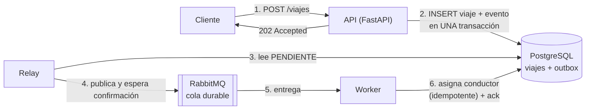

# Demo: colas de mensajes + Transactional Outbox

**Desarrollo de Software 2026 · UTN FRRe · Grupo 1**
Trabajo de investigación, Par 04: **Tema 2** (Colas de mensajes y procesamiento asíncrono) y **Tema 27** (Patrón Transactional Outbox).

| Integrante | Legajo |
|---|---|
| Brandt, Carina Noemí | 24672 |
| Caminero, Valentina | 28024 |
| Giraudo, Juan Manuel | 24332 |
| Nuñez, Lucas Emanuel | 23959 |
| Paluch Ruberto, Julián | 27229 |
| Sonza, Matías Javier | 26573 |

> **Documento de investigación:** [`documento-investigacion.pdf`](documento-investigacion.pdf).

> **Motor de base de datos:** el módulo M2 del TPI usa MongoDB, pero esta demo es un proyecto independiente y usa **PostgreSQL**. El patrón Transactional Outbox nació en bases relacionales y ahí la transacción con `BEGIN` y `COMMIT` sobre dos tablas se ve de forma directa. El documento de investigación explica qué cambia en MongoDB.

---

## Qué demuestra

Un pasajero pide un viaje. La API lo registra y responde `202 Accepted` al instante; la búsqueda del conductor, que es lenta, la hace otro proceso después.



| Pieza | Tema | Qué hace |
|---|---|---|
| `app/api.py` | Outbox | Guarda el viaje y el evento `ViajeSolicitado` en la misma transacción. **No se conecta a RabbitMQ.** |
| `app/relay.py` | Outbox | Cada 1 s publica los eventos `PENDIENTE` con *publisher confirms* y los marca `PUBLICADO`. Si RabbitMQ está caído, reintenta. |
| `app/worker.py` | Colas | Consume con ack manual y `prefetch_count=1`. Es idempotente: un evento repetido no se aplica dos veces. Los mensajes inválidos van a la Dead Letter Queue. |
| `POST /viajes/sin-outbox` | Comparación | La versión ingenua (guardar y publicar directo) para mostrar cómo se pierde el evento. |

## Requisitos

- **Docker Desktop** (con WSL en Windows), abierto y en *Engine running*.
- Nada más: Python, PostgreSQL y RabbitMQ corren dentro de contenedores.

Puertos que usa en tu PC: **8000** (API), **5432** (PostgreSQL), **5672** y **15672** (RabbitMQ). Si la API de M2 del TPI ya está corriendo en el 8000, copiá `.env.example` como `.env` y poné `API_PORT=8001`.

## Cómo levantarlo

```powershell
cd C:\Proyectos\2026-01-investigacion
docker compose up -d --build
docker compose ps
```

Tienen que aparecer `postgres`, `rabbitmq`, `api`, `relay` y `worker`. La primera vez tarda unos minutos porque descarga las imágenes.

| Qué | Dónde |
|---|---|
| Swagger de la API | http://localhost:8000/docs |
| Consola de RabbitMQ | http://localhost:15672 (usuario `demo`, contraseña `demo`) → pestaña *Queues* |
| Logs en vivo | `docker compose logs -f relay worker` |

Para no escribir el comando largo, en PowerShell podés definir un atajo en la sesión:

```powershell
function demo { docker compose exec api python -m scripts.demo @args }
```

Comandos del script (`demo <comando>`):

| Comando | Qué hace |
|---|---|
| `demo pedir 5` | Solicita 5 viajes y muestra el código y el tiempo de respuesta |
| `demo pedir 1 --sin-outbox` | Solicita un viaje con la versión sin outbox |
| `demo estado <viajeId>` | Muestra un viaje |
| `demo resumen` | Viajes por estado, eventos del outbox por estado y mensajes en las colas |
| `demo duplicar <eventoId>` | Vuelve un evento a `PENDIENTE`: el relay lo publica de nuevo |
| `demo invalido` | Publica un mensaje mal formado |

## Escenarios de la demostración

Conviene tener dos ventanas: una con `docker compose logs -f relay worker` y otra para los comandos.

### 1. Flujo normal

```powershell
demo pedir 1
demo resumen
```

La API responde `202` en milisegundos. Unos 3 segundos después el viaje está en `CONDUCTOR_ASIGNADO` y el log del worker muestra el conductor asignado.

### 2. El worker está detenido (tema 2)

```powershell
docker compose stop worker
demo pedir 5
demo resumen
```

La API sigue respondiendo `202`. El resumen muestra los viajes en `SOLICITADO` y la cola con `Ready=5`: los mensajes esperan. En la consola de RabbitMQ se ve la cola con 5 mensajes.

```powershell
docker compose start worker
```

El worker procesa los 5 mensajes pendientes, uno por vez. Nada se perdió, solo se demoró.

### 3. El worker se cae a mitad de una tarea (tema 2)

```powershell
demo pedir 1
docker compose kill worker      # dentro de los 3 segundos siguientes
demo resumen                     # el mensaje volvió a la cola: Ready=1
docker compose start worker
```

El mensaje estaba *Unacked*; al cortarse la conexión del worker, RabbitMQ lo volvió a *Ready*. El log muestra `recibido (reentregado)` y el viaje se asigna.

### 4. RabbitMQ está caído (tema 27)

```powershell
docker compose stop rabbitmq
demo pedir 3
demo resumen
```

La API sigue respondiendo `202` porque no habla con RabbitMQ. El resumen muestra `Outbox: {'PENDIENTE': 3}` y el log del relay repite `RabbitMQ no disponible, los eventos siguen PENDIENTE`.

```powershell
docker compose start rabbitmq
demo resumen
```

Cuando RabbitMQ vuelve, el relay publica los 3 eventos, el worker los procesa y el outbox queda todo en `PUBLICADO`. Ningún evento se perdió.

### 5. La misma falla sin outbox (comparación)

```powershell
docker compose stop rabbitmq
demo pedir 1 --sin-outbox
docker compose start rabbitmq
demo resumen
```

La versión sin outbox responde `500`: el viaje se guardó pero el mensaje no se pudo publicar. Aunque RabbitMQ vuelva, ese viaje queda en `SOLICITADO` para siempre, porque no hay ningún registro del evento para reintentar.

### 6. Evento duplicado (consumidor idempotente)

```powershell
docker compose exec postgres psql -U demo -c "SELECT id, estado FROM outbox LIMIT 3"
demo duplicar <un eventoId de la lista>
demo resumen
```

`duplicar` simula que el relay publicó un evento y se cayó antes de marcarlo: lo vuelve a `PENDIENTE` y el relay lo publica otra vez. El worker muestra `DUPLICADO: ya estaba procesado` y el resumen sigue con `Viajes asignados más de una vez: 0`.

### 7. Mensaje inválido (Dead Letter Queue)

```powershell
demo invalido
demo resumen
```

El worker no puede leer el mensaje, lo rechaza sin reencolar y RabbitMQ lo manda a `asignacion.viaje-solicitado.dlq`. La cola principal no se traba.

### Empezar de cero

```powershell
docker compose down -v     # -v borra también los datos de PostgreSQL y RabbitMQ
```

## Pruebas automatizadas

Las pruebas usan PostgreSQL y RabbitMQ reales, pero con una base (`demo_test`) y colas propias, así no tocan los datos de la demo.

```powershell
docker compose --profile test run --rm tests
```

| Prueba | Qué verifica |
|---|---|
| `test_api_responde_202_y_guarda_viaje_y_evento_juntos` | La API responde 202 con `Location` y guarda viaje y evento |
| `test_si_falla_el_insert_del_evento_no_queda_el_viaje` | Atomicidad: si falla el segundo INSERT, se deshace el primero |
| `test_api_funciona_con_rabbitmq_caido` | Con outbox, la API no depende del broker |
| `test_relay_publica_los_pendientes_y_los_marca` | El relay publica y marca `PUBLICADO` |
| `test_con_rabbitmq_caido_el_evento_queda_pendiente_y_se_publica_al_volver` | Con el broker caído el evento espera; al volver se publica |
| `test_si_el_broker_se_cae_al_publicar_el_evento_no_se_marca` | Solo se marca `PUBLICADO` si la publicación terminó bien |
| `test_sin_outbox_el_evento_se_pierde_si_el_broker_esta_caido` | La versión ingenua pierde el evento |
| `test_flujo_completo_api_relay_worker` | API → relay → worker deja el viaje en `CONDUCTOR_ASIGNADO` |
| `test_evento_duplicado_se_aplica_una_sola_vez` | Un evento publicado dos veces se aplica una vez |
| `test_dos_workers_con_el_mismo_evento_a_la_vez` | Sin condición de carrera con dos procesamientos simultáneos |
| `test_mensaje_invalido_va_a_la_dead_letter_queue` | Los mensajes inválidos terminan en la DLQ |
| `test_mensaje_sin_ack_vuelve_a_la_cola` | Un mensaje sin ack vuelve a la cola marcado como reentregado |

Las mismas pruebas corren en GitHub Actions en cada push (`.github/workflows/ci.yml`).

## Estructura

```
documento-investigacion.pdf   Documento de investigación
app/
  api.py          API: POST /viajes (con outbox), POST /viajes/sin-outbox, GET /viajes/{id}, GET /outbox
  viajes.py       Transacción que guarda viaje + evento
  relay.py        Relay del outbox (polling publisher)
  worker.py       Consumidor idempotente
  mensajeria.py   Conexión con RabbitMQ y declaración de colas (cola durable + DLQ)
  config.py       Configuración por variables de entorno
db/schema.sql     Tablas viajes, outbox y eventos_procesados
scripts/demo.py   Comandos para manejar la demo
tests/            Pruebas de integración (pytest)
compose.yaml      PostgreSQL, RabbitMQ, API, relay, worker y pruebas
```

## Decisiones técnicas

- **Polling publisher** en lugar de CDC (Debezium): es más simple y alcanza para mostrar el patrón. Su costo es una demora de hasta 1 s entre el commit y la publicación.
- **Publisher confirms** (`confirm_delivery`): el relay marca un evento como `PUBLICADO` solo cuando RabbitMQ confirmó que lo guardó.
- **Deduplicación con `INSERT ... ON CONFLICT DO NOTHING`** sobre `eventos_procesados`, en la misma transacción que la asignación. Evita la carrera de "consultar y después actualizar".
- **`prefetch_count=1`**: el worker recibe un mensaje a la vez; el consumo de recursos es constante aunque haya un pico.
- **Consultas parametrizadas** (`%s`) en todo el código: nada de SQL armado con texto.
- **Un solo relay**: con varias instancias habría que "reclamar" cada evento antes de publicarlo (por ejemplo, con `SELECT ... FOR UPDATE SKIP LOCKED`). Igual, el worker idempotente cubre los duplicados.
